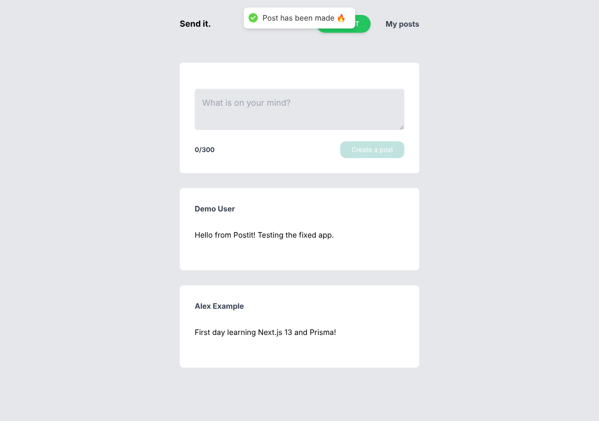
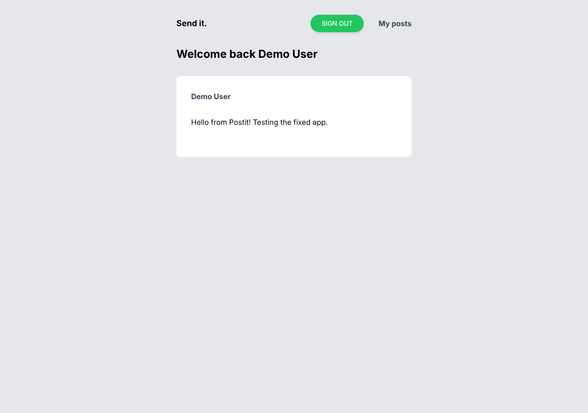

# Postit

A small social posting app: sign in with Google, write short posts, see everyone's posts on the home page, and find your own posts on your dashboard.

> Built in February 2023. Updated in October 2026 with a working dashboard, input validation, tests and CI.

## Screenshots

*Running locally with test users.*

| Home | My posts |
|---|---|
|  |  |

## Features

- Google sign-in with NextAuth, users and sessions stored with the Prisma adapter
- Write posts of up to 300 characters, with a live character counter
- Home feed with all posts, newest first
- Dashboard with your own posts
- Toast notifications for success and errors
- Server-side validation and sign-in checks on every API route
- Only public profile fields (name, picture) are sent to the browser

## Tech stack

| Area | Technology |
|---|---|
| Framework | Next.js 13 (App Router + API routes), React 18, TypeScript |
| Auth | NextAuth.js (Google OAuth), Prisma adapter |
| Database | PostgreSQL, Prisma ORM |
| Data fetching | TanStack React Query, Axios |
| UI | Tailwind CSS, react-hot-toast |
| Tests / CI | Vitest, GitHub Actions |

## How it works

```
Browser
├── /            Home: AddPost form + all posts      ──► GET  /api/posts/getPosts
│                                                   ──► POST /api/posts/addPosts
├── /dashboard   Signed-in user's posts             ──► GET  /api/posts/authPosts
└── Nav          Sign in / sign out (server component, reads the session)

API routes (pages/api)
├── auth/[...nextauth].ts   Google login, users stored via Prisma
└── posts/*                 check session ──► validate (lib/posts.ts) ──► Prisma ──► PostgreSQL
```

Data model (`prisma/schema.prisma`): `User`, `Account`, `Session`, `VerificationToken` (NextAuth) and `Post`.

## Getting started

### Prerequisites

- Node.js 18+
- PostgreSQL
- A Google OAuth client ([Google Cloud Console](https://console.cloud.google.com/apis/credentials)) with redirect URI `http://localhost:3000/api/auth/callback/google`

### Setup

```bash
git clone https://github.com/ParnaSaeidpour/postit.git
cd postit
npm install
cp .env.example .env        # then fill in your own values
npx prisma migrate dev      # creates the database tables
npm run dev                 # http://localhost:3000
```

### Environment variables

See [`.env.example`](.env.example). `.env` is in `.gitignore`, so your values are never committed.

| Variable | Purpose |
|---|---|
| `DATABASE_URL` | PostgreSQL connection string for Prisma |
| `NEXTAUTH_URL`, `NEXTAUTH_SECRET` | NextAuth base URL and session encryption secret |
| `GOOGLE_CLIENT_ID`, `GOOGLE_CLIENT_SECRET` | Google OAuth client |

## Tests

```bash
npm test
```

- `__tests__/posts.test.ts`: post text validation (empty, whitespace, 300-character limit)
- `__tests__/api.test.ts`: the three API routes with Prisma and NextAuth replaced by fakes (no database or Google login needed). Covers creating a post, sign-in checks, invalid text, wrong HTTP methods, ordering, and that email addresses are not returned.

GitHub Actions runs the tests and a production build on every push and pull request.

## Project structure

```
app/
├── page.tsx               # home feed
├── dashboard/             # signed-in user's posts
├── auth/                  # Nav, Login, Logged, React Query provider
└── components/            # AddPost, Post, types
pages/api/
├── auth/[...nextauth].ts
└── posts/                 # getPosts, addPosts, authPosts
lib/posts.ts               # validation and public user fields
prisma/                    # schema, migrations, shared client
__tests__/                 # Vitest tests
```
